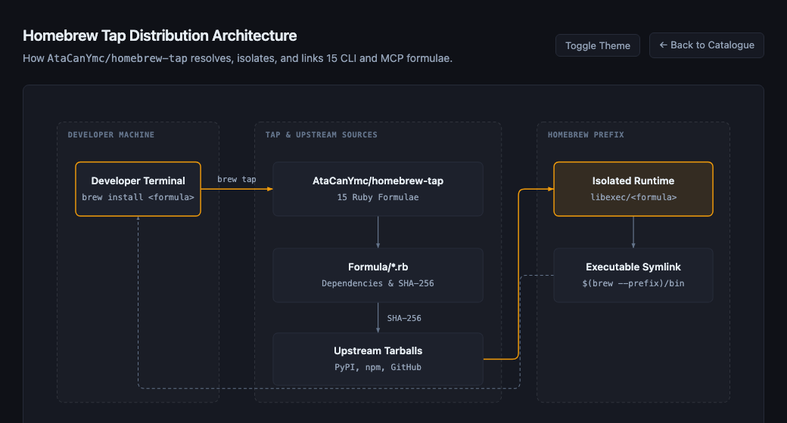

# Homebrew Tap for AtaCanYmc

[](https://github.com/AtaCanYmc/homebrew-tap/actions/workflows/tests.yml)
[](https://github.com/AtaCanYmc/homebrew-tap/actions/workflows/pages.yml)
[](LICENSE)

Official Homebrew Tap providing custom CLI formulae for macOS and Linux, maintained by Ata Can Yaymacı.

Showcase and documentation site: [https://atacanymc.github.io/homebrew-tap/](https://atacanymc.github.io/homebrew-tap/)

## Table of Contents

- [Architecture](#architecture)
- [Available Formulae](#available-formulae)
- [Quick Start](#quick-start)
  - [1. Tap the Repository](#1-tap-the-repository)
  - [2. Direct Formula Installation](#2-direct-formula-installation)
  - [3. Brewfile Integration](#3-brewfile-integration)
- [Formula Details](#formula-details)
  - [forex-pytory](#forex-pytory)
  - [home-lite-llm](#home-lite-llm)
  - [izko-gold-price-api](#izko-gold-price-api)
  - [izmir-cli](#izmir-cli)
  - [izmir-data](#izmir-data)
  - [lumina](#lumina)
  - [reels-wiki](#reels-wiki)
  - [resmi-gazete-cli](#resmi-gazete-cli)
  - [robo-market-search](#robo-market-search)
  - [rtfs](#rtfs)
  - [rubberorca](#rubberorca)
  - [rubberotter](#rubberotter)
  - [rxresume](#rxresume)
  - [stock-fetcher](#stock-fetcher)
  - [yargitay-karar-scraper](#yargitay-karar-scraper)
- [Maintenance and Local Testing](#maintenance-and-local-testing)
- [Technical FAQ](#technical-faq)
- [Contributing](#contributing)
- [Security](#security)
- [License](#license)

## Architecture

This repository distributes standalone CLI utilities and Model Context Protocol (MCP) servers packaged using Homebrew formula definitions. Python and Node.js formulae isolate dependencies inside self-contained virtual environments, preventing version conflicts with the host system.

Interactive architecture diagram: [docs/architecture.html](https://atacanymc.github.io/homebrew-tap/architecture.html)

[](https://atacanymc.github.io/homebrew-tap/architecture.html)

## Available Formulae

| Formula | Version | Description | Target Binary | License | Source Repository |
| :--- | :--- | :--- | :--- | :--- | :--- |
| [`forex-pytory`](Formula/forex-pytory.rb) | `0.2.0` | Economic calendar scraper CLI and MCP server across financial markets | `forex-scraper`, `forex-mcp` | Apache-2.0 | [AtaCanYmc/forex-pytory](https://github.com/AtaCanYmc/forex-pytory) |
| [`home-lite-llm`](Formula/home-lite-llm.rb) | `1.2.0` | Self-hosted LiteLLM gateway CLI for local and cloud AI routing | `hlm` | MIT | [AtaCanYmc/home-lite-llm](https://github.com/AtaCanYmc/home-lite-llm) |
| [`izko-gold-price-api`](Formula/izko-gold-price-api.rb) | `0.2.0` | Izmir Jewelers Chamber gold and currency rates CLI, REST API, and MCP server | `izko-gold-price-api`, `izko-gold-price-mcp` | MIT | [AtaCanYmc/izko-gold-price-api](https://github.com/AtaCanYmc/izko-gold-price-api) |
| [`izmir-cli`](Formula/izmir-cli.rb) | `2.2.0` | Izmir Buyuksehir Belediyesi Acik Veri Portali CLI Araci | `izmir-cli`, `izmir`, `izmir-mcp` | Apache-2.0 | [AtaCanYmc/izmir-open-data-js](https://github.com/AtaCanYmc/izmir-open-data-js) |
| [`izmir-data`](Formula/izmir-data.rb) | `0.3.1` | Izmir Buyuksehir Belediyesi Acik Veri Portali CLI ve MCP Sunucusu | `izmir-data`, `izmir-mcp` | Apache-2.0 | [AtaCanYmc/izmir-open-data-py](https://github.com/AtaCanYmc/izmir-open-data-py) |
| [`lumina`](Formula/lumina.rb) | `1.3.0` | Lithophane and Spiral Betty 3D Art Generator CLI | `lumina` | MIT | [AtaCanYmc/lumina](https://github.com/AtaCanYmc/lumina) |
| [`reels-wiki`](Formula/reels-wiki.rb) | `0.1.2` | Turn saved Instagram Reels into atomic Obsidian LLM Wiki notes | `reels-sync` | MIT | [AtaCanYmc/reels-wiki](https://github.com/AtaCanYmc/reels-wiki) |
| [`resmi-gazete-cli`](Formula/resmi-gazete-cli.rb) | `0.1.3` | T.C. Resmi Gazete Karar, Kanun ve İlan Scraper, CLI ve MCP Sunucusu | `resmi-gazete-cli`, `resmi-gazete-mcp` | Apache-2.0 | [AtaCanYmc/resmi-gazete-cli](https://github.com/AtaCanYmc/resmi-gazete-cli) |
| [`robo-market-search`](Formula/robo-market-search.rb) | `1.12.0` | Electronics market search and cart optimization CLI | `robo-search` | Apache-2.0 | [AtaCanYmc/robo-market-search](https://github.com/AtaCanYmc/robo-market-search) |
| [`rtfs`](Formula/rtfs.rb) | `0.1.2` | Multi-Source Movie & TV Script CLI, Python SDK, and FastMCP Server | `rtfs` | AGPL-3.0-or-later | [AtaCanYmc/rtfs](https://github.com/AtaCanYmc/rtfs) |
| [`rubberorca`](Formula/rubberorca.rb) | `0.1.4` | ESP32-S3 USB-OTG HID CLI, Python SDK, and stdio MCP server over BLE 5.0 | `rubberorca`, `rubberorca-mcp` | Apache-2.0 | [AtaCanYmc/RubberOrca](https://github.com/AtaCanYmc/RubberOrca) |
| [`rubberotter`](Formula/rubberotter.rb) | `1.4.0` | ATmega32U4 USB HID CLI, Python SDK, and MCP server over BLE and USB Serial | `rubberotter`, `otter-cli` | Apache-2.0 | [AtaCanYmc/RubberOtter](https://github.com/AtaCanYmc/RubberOtter) |
| [`rxresume`](Formula/rxresume.rb) | `0.8` | Reactive Resume API client, CLI, and FastMCP server | `rxresume`, `rxresume-mcp` | MIT | [AtaCanYmc/reactive-resume-api-client-py](https://github.com/AtaCanYmc/reactive-resume-api-client-py) |
| [`stock-fetcher`](Formula/stock-fetcher.rb) | `0.4.0` | Unified copyright-free stock image search and download CLI | `stock-fetcher` | Apache-2.0 | [AtaCanYmc/stock-fetcher](https://github.com/AtaCanYmc/stock-fetcher) |
| [`yargitay-karar-scraper`](Formula/yargitay-karar-scraper.rb) | `0.1.4` | Yargıtay Karar Arama CLI ve FastMCP Sunucusu | `yargitay-karar-cli`, `yargitay-karar-mcp` | Apache-2.0 | [AtaCanYmc/yargitay-karar-scraper](https://github.com/AtaCanYmc/yargitay-karar-scraper) |

## Quick Start

### 1. Tap the Repository

Add the tap to your local Homebrew installation:

```bash
# Tap the repository
brew tap AtaCanYmc/tap

# Install any formula
brew install forex-pytory
brew install home-lite-llm
brew install izko-gold-price-api
brew install izmir-cli
brew install izmir-data
brew install lumina
brew install reels-wiki
brew install resmi-gazete-cli
brew install robo-market-search
brew install rtfs
brew install rubberorca
brew install rubberotter
brew install rxresume
brew install stock-fetcher
brew install yargitay-karar-scraper

# Update formulae definitions
brew update
```

### 2. Direct Formula Installation

Install any formula directly without explicitly tapping beforehand:

```bash
# Install formulae directly
brew install AtaCanYmc/tap/forex-pytory
brew install AtaCanYmc/tap/home-lite-llm
brew install AtaCanYmc/tap/izko-gold-price-api
brew install AtaCanYmc/tap/izmir-cli
brew install AtaCanYmc/tap/izmir-data
brew install AtaCanYmc/tap/lumina
brew install AtaCanYmc/tap/reels-wiki
brew install AtaCanYmc/tap/resmi-gazete-cli
brew install AtaCanYmc/tap/robo-market-search
brew install AtaCanYmc/tap/rtfs
brew install AtaCanYmc/tap/rubberorca
brew install AtaCanYmc/tap/rubberotter
brew install AtaCanYmc/tap/rxresume
brew install AtaCanYmc/tap/stock-fetcher
brew install AtaCanYmc/tap/yargitay-karar-scraper
```

### 3. Brewfile Integration

To manage formulae declaratively via `brew bundle`, add the following entries to your `Brewfile`:

```ruby
tap "AtaCanYmc/tap"
brew "forex-pytory"
brew "home-lite-llm"
brew "izko-gold-price-api"
brew "izmir-cli"
brew "izmir-data"
brew "lumina"
brew "reels-wiki"
brew "resmi-gazete-cli"
brew "robo-market-search"
brew "rtfs"
brew "rubberorca"
brew "rubberotter"
brew "rxresume"
brew "stock-fetcher"
brew "yargitay-karar-scraper"
```

Apply the configuration:

```bash
brew bundle
```

## Formula Details

### forex-pytory

`forex-pytory` extracts and normalizes macroeconomic calendar events from ForexFactory, CryptoCraft, EnergyExch, and MetalsMine via CLI and FastMCP server.

```bash
# Verify installation and inspect available commands
forex-scraper --help
forex-mcp --help

# Render color-coded economic calendar table in terminal
forex-scraper --source forex --format table

# Query specific market and historical date
forex-scraper --source crypto --date 2026-05-20 --format table

# Run the FastMCP server for LLM integration
forex-mcp
```

- **Dependencies**: `python@3.12`, `cryptography`, `numpy`
- **Upstream Repository**: [https://github.com/AtaCanYmc/forex-pytory](https://github.com/AtaCanYmc/forex-pytory)

---

### home-lite-llm

`hlm` is a self-hosted LiteLLM gateway CLI for routing requests across local and cloud AI providers.

```bash
# Verify installation and inspect available commands
hlm help
```

- **Dependencies**: None
- **Upstream Repository**: [https://github.com/AtaCanYmc/home-lite-llm](https://github.com/AtaCanYmc/home-lite-llm)

---

### izko-gold-price-api

`izko-gold-price-api` scrapes live gold and currency rates from the Izmir Jewelers Chamber (`izko.org.tr`) using headless Chromium via Playwright, exposing a CLI, Flask REST API, and stdio MCP server.

```bash
# Verify installation and inspect available commands
izko-gold-price-api --help

# Fetch live rates or a single price field
izko-gold-price-api scrape --pretty
izko-gold-price-api scrape --field GramAltin

# Start the Flask REST API server
izko-gold-price-api serve --host 127.0.0.1 --port 5000

# Run the MCP server over stdio
izko-gold-price-mcp
```

- **Dependencies**: `python@3.12`
- **Upstream Repository**: [https://github.com/AtaCanYmc/izko-gold-price-api](https://github.com/AtaCanYmc/izko-gold-price-api)

---

### izmir-cli

`izmir-cli` queries Izmir Metropolitan Municipality Open Data Portal datasets, transportation schedules, and municipal services via Node.js CLI and MCP server.

```bash
# Inspect help and available subcommands
izmir-cli --help
izmir --help

# Query public transport routes
izmir ulasim hatlar

# Start the MCP server for AI integration
izmir-cli mcp
```

- **Dependencies**: `node`
- **Upstream Repository**: [https://github.com/AtaCanYmc/izmir-open-data-js](https://github.com/AtaCanYmc/izmir-open-data-js)

---

### izmir-data

`izmir-data` queries Izmir Metropolitan Municipality Open Data Portal datasets and public services via Python CLI and FastMCP server.

```bash
# Inspect help and available commands
izmir-data --help
izmir-mcp --help

# Query on-call pharmacies in Izmir
izmir-data eczaneler

# Start the FastMCP server for AI integration
izmir-mcp
```

- **Dependencies**: `python@3.12`
- **Upstream Repository**: [https://github.com/AtaCanYmc/izmir-open-data-py](https://github.com/AtaCanYmc/izmir-open-data-py)

---

### lumina

Lumina converts 2D raster images into 3D-printable lithophane STL meshes and Spiral Betty raster patterns.

```bash
# Verify installation and inspect available commands
lumina --help

# Generate a circular lithophane STL mesh
lumina flat photo.jpg --shape circle --width 120

# Generate a Spiral Betty PNG pattern
lumina spiral portrait.jpg --radius 100 --lines 40
```

- **Dependencies**: `python@3.12`, `numpy`, `opencv`
- **Upstream Repository**: [https://github.com/AtaCanYmc/lumina](https://github.com/AtaCanYmc/lumina)

---

### reels-wiki

`reels-wiki` turns saved Instagram Reels into atomic Obsidian LLM Wiki notes.

```bash
# Verify installation and inspect available commands
reels-sync --help
```

- **Dependencies**: `python@3.12`
- **Upstream Repository**: [https://github.com/AtaCanYmc/reels-wiki](https://github.com/AtaCanYmc/reels-wiki)

---

### resmi-gazete-cli

`resmi-gazete-cli` extracts and indexes official decisions, laws, and announcements from T.C. Resmi Gazete via CLI and FastMCP server.

```bash
# Verify installation and inspect available commands
resmi-gazete-cli --help
resmi-gazete-mcp --help

# Fetch today's official gazette issue
resmi-gazete-cli today

# Search decisions and announcements by keyword
resmi-gazete-cli search --query "anapara"

# Run the FastMCP server for LLM integration
resmi-gazete-mcp
```

- **Dependencies**: `python@3.12`, `cryptography`
- **Upstream Repository**: [https://github.com/AtaCanYmc/resmi-gazete-cli](https://github.com/AtaCanYmc/resmi-gazete-cli)

---

### robo-market-search

Robo Market Search queries Turkish electronic component retailers (Robotistan, SAMM Market, Direnc.net) and computes optimized shopping carts.

```bash
# Inspect available options
robo-search --help

# Search for components across supported stores
robo-search "esp32-wroom"

# Search with cart optimization filters
robo-search "raspberry pi 5"
```

- **Dependencies**: `python@3.12`
- **Upstream Repository**: [https://github.com/AtaCanYmc/robo-market-search](https://github.com/AtaCanYmc/robo-market-search)

---

### rtfs

`rtfs` searches, fetches, parses, and exports movie and TV screenplays from Script Slug, TV Writing, IMSDb, and SubsLikeScript into a structured AST and exposes a progressive-disclosure FastMCP server.

```bash
# Verify installation and inspect available commands
rtfs --help

# Search across screenplay providers
rtfs search "The Matrix"

# Export screenplay to Fountain or JSON
rtfs get "The Matrix" --format fountain --output matrix.fountain

# Display scene and speaking character analytics
rtfs stats "The Matrix"

# Start the FastMCP server via stdio
rtfs mcp --transport stdio
```

- **Dependencies**: `python@3.12`
- **Upstream Repository**: [https://github.com/AtaCanYmc/rtfs](https://github.com/AtaCanYmc/rtfs)

---

### rubberorca

`rubberorca` provides ESP32-S3 USB-OTG HID control, Python SDK, and stdio MCP server over Bluetooth Low Energy (BLE 5.0).

```bash
# Verify installation and inspect available commands
rubberorca --help
rubberorca-mcp --help

# Scan and connect to nearby ESP32-S3 BLE HID devices
rubberorca scan
rubberorca connect --name "RubberOrca-HID"

# Start the stdio MCP server for agentic automation
rubberorca-mcp
```

- **Dependencies**: `python@3.12`
- **Upstream Repository**: [https://github.com/AtaCanYmc/RubberOrca](https://github.com/AtaCanYmc/RubberOrca)

---

### rubberotter

`rubberotter` delivers ATmega32U4 USB HID keystroke injection and mouse emulation CLI, Python SDK, and MCP server over BLE and USB Serial.

```bash
# Verify installation and inspect help
rubberotter --help
otter-cli --help

# Send keystroke sequence via USB Serial
otter-cli type "Hello world" --port /dev/tty.usbmodem1101

# Launch the web controller and REST/MCP server
rubberotter serve --host 127.0.0.1 --port 8080
```

- **Dependencies**: `python@3.12`
- **Upstream Repository**: [https://github.com/AtaCanYmc/RubberOtter](https://github.com/AtaCanYmc/RubberOtter)

---

### rxresume

Reactive Resume CLI, API client, and FastMCP server for managing resumes, cover letters, job applications, and ATS matching.

```bash
# Verify installation and inspect available commands
rxresume --help
rxresume-mcp --help

# Check Reactive Resume server health and version
rxresume health

# List existing resumes
rxresume resumes list

# Export a resume to PDF, DOCX, Markdown or JSON
rxresume resumes export <resume-id> --format pdf --output cv.pdf

# Run the FastMCP server for LLM integration via stdio or SSE
rxresume mcp --transport stdio
rxresume mcp --transport sse --port 8000
```

- **Dependencies**: `python@3.14`, `pydantic`, `certifi`
- **Upstream Repository**: [https://github.com/AtaCanYmc/reactive-resume-api-client-py](https://github.com/AtaCanYmc/reactive-resume-api-client-py)

---

### stock-fetcher

Unified copyright-free stock photography search and download CLI for Pexels, Pixabay, Unsplash, and Flickr.

```bash
# Display help and available commands
stock-fetcher --help

# Search across all supported providers simultaneously
stock-fetcher find "cyberpunk neon city" --limit 3

# Search Flickr without API credentials and pipe original URLs
stock-fetcher search flickr "classic aircraft" -l 2 -f urls

# Download retrieved images directly to disk
stock-fetcher search flickr "alpine lake" -l 3 -d -o ./downloads
```

- **Dependencies**: `python@3.12`
- **Upstream Repository**: [https://github.com/AtaCanYmc/stock-fetcher](https://github.com/AtaCanYmc/stock-fetcher)

---

### yargitay-karar-scraper

Yargıtay Karar Arama CLI and FastMCP server for querying case precedents and pulling clean full text.

```bash
# Search decisions by keyword
yargitay-karar-cli search --kelime "hırsızlık"

# Detailed search with chamber and year filters
yargitay-karar-cli detailed-search --kelime "dolandırıcılık" --daire "11. Ceza Dairesi" --karar-yil "2021"

# Pull full text by decision ID
yargitay-karar-cli detail --id "120109100"

# Run the FastMCP server for LLM integration
yargitay-karar-mcp
```

- **Dependencies**: `python@3.12`, `cryptography`
- **Upstream Repository**: [https://github.com/AtaCanYmc/yargitay-karar-scraper](https://github.com/AtaCanYmc/yargitay-karar-scraper)

## Maintenance and Local Testing

When contributing or verifying formulae locally, run Homebrew's verification suite:

```bash
# 1. Audit formula syntax and Homebrew style guidelines
brew audit --strict AtaCanYmc/tap/<formula-name>

# 2. Run formula integration tests
brew test AtaCanYmc/tap/<formula-name>

# 3. Test clean build from source
brew install --build-from-source AtaCanYmc/tap/<formula-name>
```

## Technical FAQ

### How do Python formulae manage dependencies?

Formulae in this tap utilize Homebrew's `Language::Python::Virtualenv` mechanism. Each tool is built into an isolated virtual environment located in `$(brew --prefix)/Cellar/<formula>/<version>/libexec`. Binaries are symlinked into `$(brew --prefix)/bin`, ensuring system Python and global packages remain untouched.

### Can formulae be installed on Linux?

Yes. The formulae run on Linux installations powered by Homebrew on Linux (Linuxbrew). Continuous integration verifies builds against both macOS runners and official Ubuntu-based Homebrew containers.

### How do I update formulae to the latest release?

Run `brew update` to fetch the latest formula definitions from this repository, followed by `brew upgrade <formula>` or `brew upgrade` to upgrade all outdated packages.

## Contributing

See [CONTRIBUTING.md](CONTRIBUTING.md) for branch naming conventions, pull request standards, and formula authoring guidelines.

## Security

See [SECURITY.md](SECURITY.md) for our vulnerability disclosure policy and response timeline.

## License

This tap repository and its formula definitions are licensed under the MIT License. See [LICENSE](LICENSE) for details. Bundled upstream tools maintain their respective open-source licenses as noted in the [Available Formulae](#available-formulae) table.
