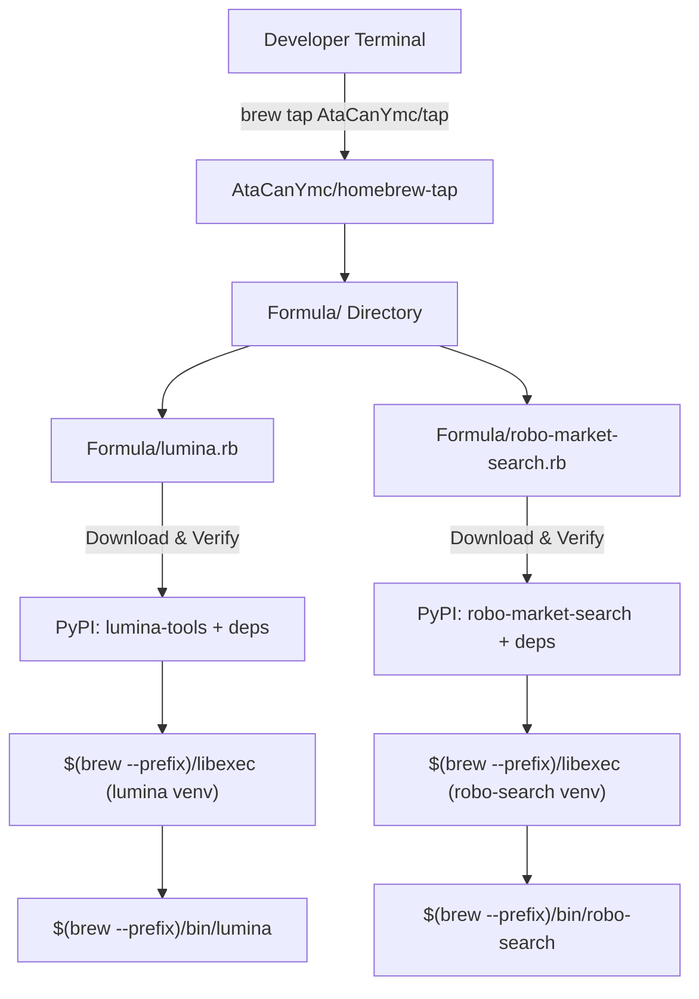

# Homebrew Tap for AtaCanYmc

[](https://github.com/AtaCanYmc/homebrew-tap/actions/workflows/tests.yml)
[](https://github.com/AtaCanYmc/homebrew-tap/actions/workflows/pages.yml)
[](LICENSE)

Official Homebrew Tap providing custom CLI formulae for macOS and Linux, maintained by Ata Can Yaymacı.

Showcase and documentation site: [https://atacanymc.github.io/homebrew-tap/](https://atacanymc.github.io/homebrew-tap/)

## Table of Contents

- [Architecture](#architecture)
- [Available Formulae](#available-formulae)
- [Quick Start](#quick-start)
  - [1. Tap the Repository](#1-tap-the-repository)
  - [2. Direct Formula Installation](#2-direct-formula-installation)
  - [3. Brewfile Integration](#3-brewfile-integration)
- [Formula Details](#formula-details)
  - [lumina](#lumina)
  - [robo-market-search](#robo-market-search)
- [Maintenance and Local Testing](#maintenance-and-local-testing)
- [Technical FAQ](#technical-faq)
- [Contributing](#contributing)
- [Security](#security)
- [License](#license)

## Architecture

This repository distributes standalone CLI utilities packaged using Homebrew formula definitions. Python-based formulae isolate dependencies inside self-contained virtual environments, preventing version conflicts with the host system.



## Available Formulae

| Formula | Version | Description | Target Binary | License | Source Repository |
| :--- | :--- | :--- | :--- | :--- | :--- |
| [`forex-pytory`](Formula/forex-pytory.rb) | `0.1.2` | Economic calendar scraper CLI and MCP server across financial markets | `forex-scraper`, `forex-mcp` | Apache-2.0 | [AtaCanYmc/forex-pytory](https://github.com/AtaCanYmc/forex-pytory) |
| [`lumina`](Formula/lumina.rb) | `1.0.0` | Lithophane and Spiral Betty 3D Art Generator CLI | `lumina` | MIT | [AtaCanYmc/lumina](https://github.com/AtaCanYmc/lumina) |
| [`resmi-gazete-cli`](Formula/resmi-gazete-cli.rb) | `0.1.1` | T.C. Resmi Gazete Karar, Kanun ve İlan Scraper, CLI ve MCP Sunucusu | `resmi-gazete-cli`, `resmi-gazete-mcp` | Apache-2.0 | [AtaCanYmc/resmi-gazete-cli](https://github.com/AtaCanYmc/resmi-gazete-cli) |
| [`robo-market-search`](Formula/robo-market-search.rb) | `1.10.0` | Electronics market search and cart optimization CLI | `robo-search` | Apache-2.0 | [AtaCanYmc/robo-market-search](https://github.com/AtaCanYmc/robo-market-search) |
| [`yargitay-karar-scraper`](Formula/yargitay-karar-scraper.rb) | `0.1.1` | Yargıtay Karar Arama CLI ve FastMCP Sunucusu | `yargitay-karar-cli`, `yargitay-karar-mcp` | Apache-2.0 | [AtaCanYmc/yargitay-karar-scraper](https://github.com/AtaCanYmc/yargitay-karar-scraper) |

## Quick Start

### 1. Tap the Repository

Add the tap to your local Homebrew installation:

```bash
# Tap the repository
brew tap AtaCanYmc/tap

# Install any formula
brew install lumina
brew install robo-market-search

# Update formulae definitions
brew update
```

### 2. Direct Formula Installation

Install any formula directly without explicitly tapping beforehand:

```bash
# Install lumina directly
brew install AtaCanYmc/tap/lumina

# Install robo-market-search directly
brew install AtaCanYmc/tap/robo-market-search
```

### 3. Brewfile Integration

To manage formulae declaratively via `brew bundle`, add the following entries to your `Brewfile`:

```ruby
tap "AtaCanYmc/tap"
brew "lumina"
brew "robo-market-search"
```

Apply the configuration:

```bash
brew bundle
```

## Formula Details

### forex-pytory

`forex-pytory` extracts and normalizes macroeconomic calendar events from ForexFactory, CryptoCraft, EnergyExch, and MetalsMine via CLI and MCP server.

```bash
# Verify installation and inspect available commands
forex-scraper --help
forex-mcp --help

# Render color-coded economic calendar table in terminal
forex-scraper --source forex --format table

# Query specific market and historical date
forex-scraper --source crypto --date 2026-05-20 --format table
```

- **Dependencies**: `python@3.12`, `cryptography`, `numpy`
- **Upstream Repository**: [https://github.com/AtaCanYmc/forex-pytory](https://github.com/AtaCanYmc/forex-pytory)

---

### lumina

Lumina converts 2D raster images into 3D-printable lithophane STL meshes and Spiral Betty raster patterns.

```bash
# Verify installation and inspect available commands
lumina --help

# Generate a circular lithophane STL mesh
lumina flat photo.jpg --shape circle --width 120

# Generate a Spiral Betty PNG pattern
lumina spiral portrait.jpg --radius 100 --lines 40
```

- **Dependencies**: `python@3.12`, `numpy`, `opencv`
- **Upstream Repository**: [https://github.com/AtaCanYmc/lumina](https://github.com/AtaCanYmc/lumina)

---

### robo-market-search

Robo Market Search queries Turkish electronic component retailers (Robotistan, SAMM Market, Direnc.net) and computes optimized shopping carts.

```bash
# Inspect available options
robo-search --help

# Search for components across supported stores
robo-search "esp32-wroom"

# Search with cart optimization filters
robo-search "raspberry pi 5"
```

- **Dependencies**: `python@3.12`
- **Upstream Repository**: [https://github.com/AtaCanYmc/robo-market-search](https://github.com/AtaCanYmc/robo-market-search)

---

### yargitay-karar-scraper

Yargıtay Karar Arama CLI and FastMCP server for querying case precedents and pulling clean full text.

```bash
# Search decisions by keyword
yargitay-karar-cli search --kelime "hırsızlık"

# Detailed search with chamber and year filters
yargitay-karar-cli detailed-search --kelime "dolandırıcılık" --daire "11. Ceza Dairesi" --karar-yil "2021"

# Pull full text by decision ID
yargitay-karar-cli detail --id "120109100"

# Run the FastMCP server for LLM integration
yargitay-karar-mcp
```

- **Dependencies**: `python@3.12`, `cryptography`
- **Upstream Repository**: [https://github.com/AtaCanYmc/yargitay-karar-scraper](https://github.com/AtaCanYmc/yargitay-karar-scraper)

## Maintenance and Local Testing

When contributing or verifying formulae locally, run Homebrew's verification suite:

```bash
# 1. Audit formula syntax and Homebrew style guidelines
brew audit --strict AtaCanYmc/tap/lumina
brew audit --strict AtaCanYmc/tap/robo-market-search

# 2. Run formula integration tests
brew test AtaCanYmc/tap/lumina
brew test AtaCanYmc/tap/robo-market-search

# 3. Test clean build from source
brew install --build-from-source AtaCanYmc/tap/lumina
brew install --build-from-source AtaCanYmc/tap/robo-market-search
```

## Technical FAQ

### How do Python formulae manage dependencies?
Formulae in this tap utilize Homebrew's `Language::Python::Virtualenv` mechanism. Each tool is built into an isolated virtual environment located in `$(brew --prefix)/Cellar/<formula>/<version>/libexec`. Binaries are symlinked into `$(brew --prefix)/bin`, ensuring system Python and global packages remain untouched.

### Can formulae be installed on Linux?
Yes. The formulae run on Linux installations powered by Homebrew on Linux (Linuxbrew). Continuous integration verifies builds against both macOS runners and official Ubuntu-based Homebrew containers.

### How do I update formulae to the latest release?
Run `brew update` to fetch the latest formula definitions from this repository, followed by `brew upgrade <formula>` or `brew upgrade` to upgrade all outdated packages.

## Contributing

See [CONTRIBUTING.md](CONTRIBUTING.md) for branch naming conventions, pull request standards, and formula authoring guidelines.

## Security

See [SECURITY.md](SECURITY.md) for our vulnerability disclosure policy and response timeline.

## License

This tap repository and its formula definitions are licensed under the MIT License. See [LICENSE](LICENSE) for details. Bundled upstream tools maintain their respective open-source licenses as noted in the [Available Formulae](#available-formulae) table.
